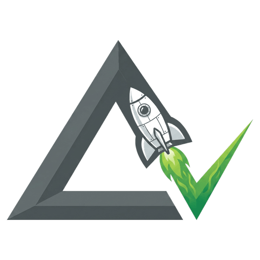
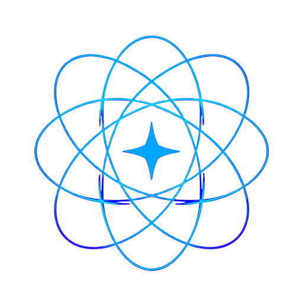

<div align="center">

# Dhaatrik Chowdhury
### First-Principles Thinker • AI Systems Architect • Open-Source Builder

[](https://dhaatrik.github.io)
[](https://dhaatrik.github.io/transmissions/)
[](https://github.com/dhaatrik)
[](https://x.com/dhaatrik)
[](https://linkedin.com/in/dhaatrik)

<br>

<p align="center">
  <b><code>SYS.STATUS: OPERATIONAL</code></b> &nbsp;•&nbsp; 
  <b><code>FOCUS: AGRI-AI</code></b> &nbsp;•&nbsp; 
  <b><code>BASE: INDIA</code></b>
</p>

```text
====================================================================
// TRANSMISSION METADATA // SYSTEM OVERVIEW
--------------------------------------------------------------------
- PILOT: Dhaatrik Chowdhury (India)
- CORE AXIOM: Break problems down to fundamental truths, avoid shortcuts.
- STATUS: Active on Agriculture AI
- PEDAGOGY: Taught physics & math for 9 years; stepped back in 2025.
====================================================================
```

</div>

---

### Mission Telemetry

Hey, I'm Dhaatrik. I build software by deconstructing problems into their core physical and mathematical constraints. 

- **Current Focus:** Building practical AI tools for agriculture. Farming has hard physical constraints. I focus on solving direct operational bottlenecks for farmers rather than wrapping generic API prompts.
- **Systems & Simulations:** Building browser sandboxes that do heavy computation on the client. DeltaV Lab runs 50Hz RK4 physics in a dedicated web worker, The Infinite Intelligence coordinates multi-agent LLM debates, and Vellor manages business records in local encrypted storage.
- **Teaching Roots (2016–2025 Archive):** I spent nine years tutoring roughly 200 students in physics and mathematics. I founded [DBS Classes](https://dhaatrik.github.io/pedagogy/) on YouTube with one rule: *"Education is not free, but knowledge is free."* In 2025, I stepped away from teaching to focus full time on software engineering. That classroom rigor still dictates how I structure systems and explain technical trade-offs.
- **Open Comms:** Always down to discuss orbital mechanics, agent orchestration, recommendation engines, or startup mistakes. Drop a message on X or LinkedIn.

---

### Flagship Projects

| Project | System & Mission | Core Stack | Telemetry & Code |
| :---: | :--- | :--- | :--- |
| [<br>**DeltaV Lab**](https://dhaatrik.github.io/projects/deltav-lab/) | **Browser Rocket Simulator**<br>Deterministic 50Hz 4th-order physics engine in a Web Worker. Includes a Vehicle Assembly Building (VAB) and a DSL flight computer. | `TypeScript`<br>`Web Workers`<br>`SharedArrayBuffer`<br>`Vitest` | [Source Code](https://github.com/dhaatrik/professional-rocket-launch-simulation)<br>[Mission Log](https://dhaatrik.github.io/projects/deltav-lab/)<br>[Physics Derivations](https://dhaatrik.github.io/transmissions/deltav-lab-science/) |
| [<br>**Vellor**](https://dhaatrik.github.io/projects/vellor/) | **Offline Tutoring Operations OS**<br>Free, MIT-licensed PWA for independent tutors. Stores student rosters and logs with client-side AES-GCM encryption. Zero backend, zero subscriptions. | `React 19`<br>`TypeScript`<br>`Zustand 5`<br>`AES-GCM` • `PWA` | [Source Code](https://github.com/dhaatrik/vellor)<br>[Mission Log](https://dhaatrik.github.io/projects/vellor/)<br>[Architecture Doc](https://dhaatrik.github.io/transmissions/vellor-tech-stack/) |
| [<br>**The Infinite Intelligence**](https://dhaatrik.github.io/projects/the-infinite-intelligence/) | **BYOK Multi-Agent LLM Council**<br>Client-side orchestration engine running multi-persona debates with Human-in-the-Loop steering, session branching, and PDF synthesis. | `React 19`<br>`TypeScript`<br>`@google/genai`<br>`Motion` | [Source Code](https://github.com/dhaatrik/the-infinite-intelligence)<br>[Mission Log](https://dhaatrik.github.io/projects/the-infinite-intelligence/)<br>[Guardrails Doc](https://dhaatrik.github.io/transmissions/infinite-intelligence-byok-guardrails/) |
| [<br>**FuelDrop**](https://dhaatrik.github.io/projects/fueldrop/) | **Frontend Fuel Logistics Demo**<br>Interactive client prototype for on-demand fuel delivery with customer ordering, captain dispatch, and Leaflet map UI on mock state. | `React 19`<br>`TypeScript`<br>`Tailwind CSS`<br>`Leaflet` • `PWA` | [Source Code](https://github.com/dhaatrik/fueldrop)<br>[Mission Log](https://dhaatrik.github.io/projects/fueldrop/)<br>[Tech Stack Doc](https://dhaatrik.github.io/transmissions/fueldrop-why-and-what/) |

<br>

<details>
<summary><b>Architecture Deep Dives &amp; Failure Postmortems</b> (Click to expand)</summary>

<br>

#### 1. DeltaV Lab — Trajectory Sandbox & RK4 Integration
- **The Architecture:** Separated the numerical physics loop from rendering by running fixed-timestep RK4 ($dt = 0.02\,\text{s}$, 50 Hz) inside a dedicated Web Worker. Telemetry synchronizes via `SharedArrayBuffer` so DOM repaints never pause integration. Includes a custom `WHEN <condition> THEN <action>` DSL flight computer, pre-launch Go/No-Go checklists, and Flight Termination System interlocks.
- **The Fuckup & Root Cause:** I initially passed hundreds of discrete coordinate objects through standard `postMessage` on every frame. This flooded the event queue, stalled the worker, and ruined integration timing. I fixed it by switching to contiguous shared memory buffers.
- **Honest Limitations:** DeltaV Lab is a 2D pedagogical sandbox with an exponential atmosphere (7 km scale height) and simplified Dryden wind gusts. It is not 6DOF flight-certified software with published validation data.
- **Deep Transmissions:** [Why It's Not Professional Grade](https://dhaatrik.github.io/transmissions/deltav-lab-not-professional-grade/) • [Native Physics Core Migration](https://dhaatrik.github.io/transmissions/deltav-lab-native-physics-core/)

#### 2. Vellor — Zero-Knowledge Local Tutoring OS
- **The Architecture:** Runs entirely on the client device. All data is encrypted with AES-GCM before writing to `localStorage`. Features virtualized student rosters and $O(N)$ operations for instant lookups on low-end hardware.
- **The Fuckup & Root Cause:** I almost derailed the project by building RPG-style gamification, badges, and levels. That visual noise cluttered the core payment and lesson logging path. I stripped celebration chrome from the transaction flow and moved gamification into a separate optional view.
- **Honest Limitations:** Zero-server architecture means no automatic multi-device synchronization. Users own their disaster recovery through JSON exports.
- **Deep Transmissions:** [The Gamification Trap](https://dhaatrik.github.io/transmissions/vellor-gamification-trap/) • [Local Backup Reality](https://dhaatrik.github.io/transmissions/vellor-local-backup-reality/)

#### 3. The Infinite Intelligence — Multi-Model Peer Review
- **The Architecture:** Breaks prompts into first-principles constraints and coordinates parallel, sequential, or round-robin debate cycles between distinct personas, with Human-in-the-Loop steering to guide synthesis.
- **The Fuckup & Root Cause:** I ran an unbounded debate test without recursion caps using vague critic prompts. The agents argued in a loop and drained API key rate limits in minutes. I added hard round ceilings, live token tracking, and cost estimation telemetry.
- **Honest Limitations:** Client-side BYOK tool. Token costs scale with agents $\times$ rounds $\times$ prompt size.
- **Deep Transmissions:** [BYOK Economics & Guardrails](https://dhaatrik.github.io/transmissions/infinite-intelligence-byok-guardrails/) • [Why a Council of Models](https://dhaatrik.github.io/transmissions/infinite-intelligence-why-and-what/)

#### 4. FuelDrop — On-Demand Fuel Logistics Interface
- **The Architecture:** Delivery interface prototyping customer orders, captain job dispatching (`/captain`), emergency surge logic, and fleet bulk orders.
- **The Fuckup & Root Cause:** I initially described this project on my portfolio using words that implied production WebSocket backends and database transaction rollbacks. That was inaccurate. The repo is an interactive client demo running on simulated OTP (`1234`) and mock state. Stating the exact boundary between prototype and production infrastructure is mandatory.
- **Deep Transmissions:** [UX Prototype vs. Real Logistics](https://dhaatrik.github.io/transmissions/fueldrop-why-and-what/) • [Client-Only Tech Stack](https://dhaatrik.github.io/transmissions/fueldrop-tech-stack/)

</details>

---

### Technical Arsenal

<div align="center">

#### AI, Systems Modeling & Mathematics


#### Frontend & Client Architecture


#### Backend, Cloud & Storage


</div>

---

### Engineering Transmissions & Mission Logs

Selected deep dives from [dhaatrik.github.io/transmissions](https://dhaatrik.github.io/transmissions/):

- [DeltaV Lab: The Science & RK4 Worker Architecture](https://dhaatrik.github.io/transmissions/deltav-lab-science/) — Derivations, thrust integration, dynamic pressure, and worker protocol design.
- [DeltaV Lab: Honest Limitations & Not Professional Grade](https://dhaatrik.github.io/transmissions/deltav-lab-not-professional-grade/) — Why plain truth beats marketing bravado in simulation software.
- [Vellor: AES-GCM Encrypted Local Storage Architecture](https://dhaatrik.github.io/transmissions/vellor-tech-stack/) — Zero-knowledge privacy guarantees for educators without monthly SaaS taxes.
- [Vellor: The Gamification Trap](https://dhaatrik.github.io/transmissions/vellor-gamification-trap/) — How gamification chrome threatened to overshadow business operations and how we corrected course.
- [The Infinite Intelligence: BYOK Economics & Guardrails](https://dhaatrik.github.io/transmissions/infinite-intelligence-byok-guardrails/) — Architecting safeguards against runaway multi-agent critique loops.
- [Teaching from First Principles & DBS Classes](https://dhaatrik.github.io/transmissions/teaching-from-first-principles/) — The foundational pedagogy of breaking physics down to physical reality (2016–2025 archive).

---

### Connect

Have a project idea, want to debate orbital dynamics, or explore an AI architecture? Reach out:

<div align="center">

[](https://x.com/dhaatrik)
[](https://linkedin.com/in/dhaatrik)
[](https://medium.com/@dhaatrik)
[](https://facebook.com/dhaatrikchowdhury)
[](https://instagram.com/dhaatrik_chowdhury)

</div>
